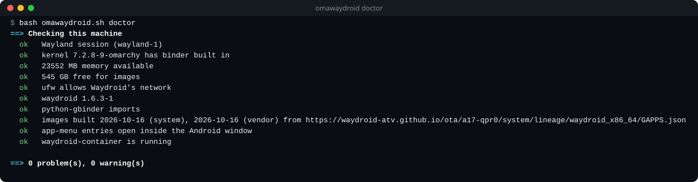

<h1 align="center">omawaydroid</h1>

<p align="center">
  <a href="https://github.com/GreyforgeLabs/omawaydroid/releases/latest"></a>
  <a href="LICENSE"></a>
  
  
</p>

<p align="center"><b>Waydroid that just works on Omarchy and Arch Linux.</b></p>

<p align="center">
  <a href="#install">Install</a> ·
  <a href="#first-run">First run</a> ·
  <a href="#what-it-fixes">What it fixes</a> ·
  <a href="#commands">Commands</a> ·
  <a href="#troubleshooting">Troubleshooting</a> ·
  <a href="#uninstall">Uninstall</a>
</p>

---

One command installs [Waydroid](https://github.com/waydroid/waydroid), opens your firewall for it,
downloads Android 13, 16 or 17 from a fast mirror, checks every image against its SHA-256, and
starts the container. A read-only `doctor` command checks the things that most often stop Waydroid
on Arch-based desktops and prints the fix for each one.

omawaydroid builds on the work of the Waydroid project and
[WayDroid-ATV](https://github.com/WayDroid-ATV/waydroid-builds). It uses the stock `waydroid`
package from the Arch repositories and changes nothing inside it.

## Install

```sh
bash <(curl -fsSL https://raw.githubusercontent.com/GreyforgeLabs/omawaydroid/main/omawaydroid.sh) install --android 17
```

Run it as your normal user; it asks for `sudo` for the root steps. Use `--android 16`, or leave the
option out for Android 13. When it finishes, start Android with `waydroid show-full-ui` or open any
Android app from your app menu.

To keep the script for `doctor` and `uninstall`, download the v0.1.0 release and check it first:

<!-- On each release, update the tag and the sha256 below to the new omawaydroid.sh asset. -->
```sh
curl -fsSLO https://github.com/GreyforgeLabs/omawaydroid/releases/download/v0.1.0/omawaydroid.sh
echo "0467e30991a7948f237da7b735da25725acfb2a99397c37e0e6979b6d2fa331b  omawaydroid.sh" | sha256sum -c
bash omawaydroid.sh install --android 17
```

On Omarchy (kernel 7.2.8, Hyprland, AMD) a full install takes about 2.5 minutes on a typical
connection, Android 17 cold-starts in 19 seconds, and SuperTuxKart runs at 60 FPS, including
through ARM translation.

<p align="center">
  
</p>

## First run

1. **Check the machine.** `bash omawaydroid.sh doctor` changes nothing. It reports the Wayland
   session, the kernel's binder driver, free memory and disk, the firewall and, once Waydroid is
   installed, the images and the container. Every `fail` and `warn` line names its fix. It may ask
   for `sudo` to read the firewall rules.
2. **Install.** `bash omawaydroid.sh install --android 17` installs Waydroid, adds the firewall rules
   it needs, downloads and verifies the images, and starts `waydroid-container`. Downloads resume if
   the connection drops; run the same command again.
3. **Start Android.** `waydroid show-full-ui` opens the Android window. On Android 16 and 17 it opens
   at the home screen, and with Google apps the first start shows Google's setup screens; finish
   them once and apps open normally after that. On Android 13 with Google apps, register the device
   for the Play Store first, as the
   [Waydroid docs](https://docs.waydro.id/faq/google-play-certification) describe.
4. **Add apps.** Install from the Play Store inside Android, or sideload an APK with
   `waydroid app install app.apk`. Android apps appear in your desktop app menu, and on Android 16
   and 17 they open inside the Android window.
5. **Stay current.** `sudo waydroid upgrade` pulls new images from the same update channel that
   omawaydroid set up. As of v0.1.0, Android 17 carries the October 2026 security patch.

## What it fixes

| Problem | What omawaydroid does |
|---|---|
| Android gets no IP address behind ufw (Omarchy's default firewall) | Adds only the missing DHCP, DNS and forwarding rules for `waydroid0`, never changes rules you made, and removes only its own on uninstall; firewalld gets `waydroid0` in the trusted zone |
| Image downloads stall on a slow SourceForge mirror | Downloads from the fastest working mirror, resumes, verifies the channel's SHA-256, then hands the files to the stock `waydroid init`; `waydroid upgrade` keeps using the official channel |
| A leftover `binder_linux-dkms` freezes kernels that already have binder ([omarchy#16625](https://github.com/omacom/omarchy/issues/16625)) | `doctor` detects it and prints the removal commands |
| Android 16 and 17 open no window for apps started from the app menu | Adds a launcher wrapper that opens them in the Android window |
| Kernel without binder, broken `python-gbinder` after a Python upgrade, no Wayland session, low memory or disk | `doctor` explains each one and the fix |

The firewall fix is also offered upstream in
[waydroid/waydroid#2458](https://github.com/waydroid/waydroid/pull/2458).

## Commands

```
omawaydroid.sh install [--android 13|16|17] [--vanilla] [--force]
omawaydroid.sh doctor
omawaydroid.sh uninstall [--purge]
omawaydroid.sh --version
```

- `--android 13` (default) uses the official Waydroid images.
- `--android 16` and `--android 17` install Android 16 or 17, built by
  [WayDroid-ATV](https://github.com/WayDroid-ATV/waydroid-builds). omawaydroid sets them up to behave
  like Android 13 does:
  - Android 16 comes from the builder's fixed 2026-08-03 build (checksum-pinned) until the Android 16
    update channel publishes something newer; `waydroid upgrade` then moves to it.
  - Apps opened from your app menu appear in the Android window: omawaydroid adds a small `waydroid`
    wrapper in `~/.local/bin` that opens the window after launching an app. Everything else passes
    straight through to Waydroid.
  - Android starts at the home screen instead of a lock screen.
  - Android 16 is available with Google apps only.
- `--vanilla` installs Android without Google apps.
- `--force` switches an existing install to a different channel. Android data is kept, and a different
  Android version may not boot on it; `uninstall --purge` first gives a clean switch.
- `doctor` is read-only and exits non-zero when it finds a problem, so it also works in scripts.
- `uninstall` stops Waydroid and removes only the changes omawaydroid made; `--purge` also removes
  the package and all Android data. See [Uninstall](#uninstall).

Image downloads are cached in `~/.cache/omawaydroid` and resume if interrupted. Set
`OMAWAYDROID_MIN_BPS` to change the speed below which a mirror is abandoned (default 100000 bytes
per second).

## Requirements

- An x86_64 Arch-based system: Omarchy, Arch, EndeavourOS or CachyOS.
- A Wayland session.
- A kernel with binder: Omarchy's kernel 7.2.8-9 or newer, or Arch's `linux`, `linux-zen` or
  `linux-lts`.
- About 2 GB of free memory and 8 GB of free disk under `/var/lib`.

## Troubleshooting

Start with `bash omawaydroid.sh doctor`. In this example it finds a leftover DKMS module and a firewall that
would block Android's network, and says what to do about each:

```
==> Checking this machine
  ok   Wayland session (wayland-1)
  ok   kernel 7.2.8-9-omarchy has binder built in
  fail a leftover binder DKMS module collides with the built-in driver (EBUSY at boot, random freezes; omarchy#16625):
         package binder_linux-dkms
         fix: sudo pacman -Rns binder_linux-dkms   (and remove binder_linux from /etc/modules-load.d), then reboot
  ok   23552 MB memory available
  ok   545 GB free for images
  warn ufw is active and blocks Waydroid's DHCP, DNS or forwarding (4 rule(s) missing; Android gets no network); install adds them
  --   Waydroid not installed

==> 1 problem(s), 1 warning(s)
```

| What you see | What to do |
|---|---|
| `no Wayland session` | Run omawaydroid from your Wayland desktop. From X11, run Waydroid inside `cage` or `weston`. |
| `kernel ... has no binder driver` | Update the system (`omarchy-update` on Omarchy) or install `linux-zen`, then reboot. |
| `binder comes from a DKMS module` | It works, though a kernel update can stop it. Omarchy's kernel 7.2.8-9 and newer and Arch's `linux`, `linux-zen` and `linux-lts` have binder built in. |
| `python-gbinder is broken` | `sudo pacman -Syu python-gbinder`. This usually follows a Python upgrade. |
| `... holds Waydroid images` | Remove the preinstalled images in `/etc/waydroid-extra/images` or `/usr/share/waydroid-extra/images`; they override downloaded ones and block updates. |
| Android has no network | Run `install` again; it adds the missing ufw rules. With firewalld, move `waydroid0` to the `trusted` zone if `install` reports another zone. |
| `an earlier install stopped half-way` or `no Android image installed yet` | Run `install` again. Finished downloads are reused. |
| Android 16/17 apps from the app menu do not appear | Run `install` again to add the launcher. If `install` says `~/.local/bin` is not ahead of `/usr/bin` in your desktop session's `PATH`, put it first and log in again. |
| `Android did not start` notification | Run `bash omawaydroid.sh doctor`; the wrapper waits up to three minutes for Android to boot. |
| The fixed Android 16 build cannot be downloaded | Try again later, or use `--android 17`. |
| `did not match its checksum` | Run `install` again; it downloads that file fresh. |
| `Waydroid is set up from ...` | You asked for a different channel. Add `--force` to switch and keep your data, or run `uninstall --purge` first for a clean switch. |

## Uninstall

```sh
bash omawaydroid.sh uninstall
```

This stops Waydroid and disables `waydroid-container`. It removes the firewall rules omawaydroid
added (recorded in `~/.local/state/omawaydroid`), the Android 16/17 launcher, the lock-screen setting
and the download cache. Your Waydroid install and Android data stay.

```sh
bash omawaydroid.sh uninstall --purge
```

This also removes the `waydroid` package, `/var/lib/waydroid`, your Android data in
`~/.local/share/waydroid` and the Android app menu entries. Waydroid's dependencies stay installed;
`pacman -Qdt` lists them.

## Credits

- [Waydroid](https://github.com/waydroid/waydroid): the container runtime and the official Android 13 images.
- [WayDroid-ATV](https://github.com/WayDroid-ATV/waydroid-builds): the Android 16 and 17 images.
- [Omarchy](https://github.com/omacom/omarchy): the kernel with binder built in.

## License

MIT © 2026 Greyforge Labs. See [LICENSE](LICENSE).

---

<p align="center">
  <b>Android running on your desktop?</b> <a href="https://github.com/GreyforgeLabs/omawaydroid">Star omawaydroid on GitHub</a> · <a href="https://x.com/GreyforgeLabs">Follow @GreyforgeLabs</a> · <a href="https://greyforge.tech/open-source">More Omarchy tools at greyforge.tech</a>
</p>
